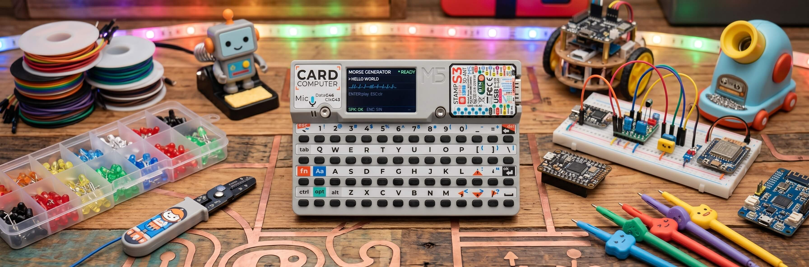

# MORSE CODE GENERATOR — M5Stack Cardputer v1.1

[](https://docs.micropython.org/)
[](https://aiflow.m5stack.com/)
[](https://docs.m5stack.com/en/device/Cardputer)
[](LICENSE)

<p align="center"></p>

A Morse code generator for the **M5Stack Cardputer v1.1 (K132)** running MicroPython / UIFlow2. Type text (A-Z, 0-9), see the Morse code on screen, and hear it played through the built-in speaker with PCM sine-wave audio.

---

## Features

- 📡 Real-time Morse preview — as you type, the dot-dash sequence appears instantly on screen
- 🔊 Two audio engines — PCM sine wave (440 Hz carrier) with automatic fallback to square-wave `tone()`
- ⌨️ Full keyboard input via the Cardputer's matrix keyboard (A-Z, 0-9, space)
- 📊 Progress bar with percentage readout during playback
- 🎯 Intuitive controls — Enter to play/stop, Backspace to delete, ESC to clear
- 🎛️ Hardware BtnA shortcut to toggle playback
- 🖥️ Polished dark UI with status indicators (READY / PLAY / NOAUD)
- ⚙️ Tunable audio parameters — frequency, volume, and timing units configurable at the top of the source

---

## Architecture

```
┌──────────────────────────────────────────────────────┐
│                    main.py                           │
│  ┌───────────┐ ┌──────────┐ ┌─────────────────────┐  │
│  │  DISPLAY  │ │ KEYBOARD │ │      AUDIO ENGINE   │  │
│  │ (M5.Lcd)  │ │(MatrixKB)│ │(Speaker: PCM / tone)│  │
│  └─────┬─────┘ └─────┬────┘ └──────────┬──────────┘  │
│        │             │                 │             │
│  ┌─────▼─────────────▼─────────────────▼──────────┐  │
│  │              STATE (S dict)                    │  │
│  │   input text · morse string · seq_events[]     │  │
│  │   audio engine · playback progress · UI state  │  │
│  └─────────────────────┬──────────────────────────┘  │
│                        │                             │
│  ┌─────────────────────▼──────────────────────────┐  │
│  │            service_morse() (main loop)         │  │
│  │   ticks-based timing · event scheduler         │  │
│  │   (dot, dash, intra-gap, inter-gap, word-gap)  │  │
│  └────────────────────────────────────────────────┘  │
└──────────────────────────────────────────────────────┘
```

### Key Design Decisions

| Aspect | Detail |
|--------|--------|
| **Morse timing** | Base unit = 90 ms. Dot = 1×, Dash = 3×, intra-character gap = 1×, inter-character gap = 3×, word gap = 7× |
| **Audio priority** | Tries `Speaker.playRaw()` (PCM sine buffer) first; falls back to `Speaker.tone()` (square wave) if PCM API is unavailable |
| **PCM pre-build** | Both dot and dash PCM buffers are built once at `setup()` and cached globally to avoid repeated allocation |
| **Non-blocking playback** | `service_morse()` runs in the main loop using `time.ticks_ms()` — no `sleep()` calls, UI stays responsive |
| **Input buffer** | Max 25 characters. Only uppercase A-Z and digits 0-9 are accepted |

---

## Project Structure

```
M5Cardputer-Morse-Code-Generator/
├── src/
│   └── main.py          # Complete application (~586 lines)
├── docs/
│   └── banner.jpg       # Project banner image
└── README.md
```

### Configurable Constants (top of `main.py`)

```python
MORSE_FREQ = 800        # Hz — carrier tone frequency
MORSE_VOL  = 90         # 0..100 — playback volume
UNIT       = 90         # ms — base timing unit for all Morse intervals
```

---

## Hardware Requirements

- **M5Stack Cardputer v1.1 (K132)** — ESP32-S3, 1.9" touch display, built-in matrix keyboard, speaker + mic
- No additional peripherals or configuration needed — everything runs from the built-in hardware

---

## How to Flash

### Prerequisites

1. Install [UIFlow2](https://aiflow.m5stack.com/) and connect your Cardputer via USB.
2. In UIFlow2, select **M5Stack-Cardputer** as the device and create a **blank project**.
3. Make sure the firmware image includes the **MatrixKeyboard** and **Speaker** modules.

### Step 1 — Flash the application

1. Switch the UIFlow2 editor to **Code mode** (Python).
2. Copy the entire contents of `src/main.py` and paste them into the editor.
3. Click **Flash** to write the program to the Cardputer.

### Step 2 — Run

After flashing, the Cardputer will:

1. Initialize the display, keyboard driver, and audio engine.
2. Pre-build the PCM buffers for dot and dash tones.
3. Show the idle UI — type text on the keyboard and the Morse preview updates in real time.
4. Press **Enter** (or **BtnA**) to play the sequence through the speaker.

> **Note:** The Cardputer keyboard may enter a low-power sleep state after boot. Hold **FN** and press any key to wake the keyboard driver.

---

## Using the App

### Controls

| Key | Action |
|-----|--------|
| **A – Z** | Type letter (auto upper-cased) |
| **0 – 9** | Type digit |
| **Space** | Insert word separator (Morse `//`) |
| **Enter** | Start / Stop playback |
| **⌫ (Backspace)** | Delete last character (also stops playback if active) |
| **ESC** | Clear input and preview entirely |
| **BtnA** (hardware) | Toggle playback on/off |

### On-Screen Status

| Indicator | Meaning |
|-----------|---------|
| **READY** (green dot) | Audio engine initialized, ready to play |
| **PLAY** (cyan dot) | Morse sequence currently playing |
| **NOAUD** (red dot) | Audio engine failed to initialize — playback will be silent |
| Progress bar + `%` | Real-time playback progress |
| `SPK: OK/OFF` + `ENG: SIN/SQR` | Speaker status and active audio engine |

---

## Morse Reference (built-in)

All 26 letters and 10 digits are supported. The table is defined at the top of `main.py`:

```
A .-      B -...    C -.-.    D -..     E .       F ..-.
G --.     H ....    I ..      J .---    K -.-     L .-..
M --      N -.      O ---     P .--.    Q --.-    R .-.
S ...     T -       U ..-     V ...-    W .--     X -..-
Y -.--    Z --..
0 -----   1 .----   2 ..---   3 ...--   4 ....-
5 .....   6 -....   7 --...   8 ---..   9 ----.
```

---

## Troubleshooting

| Symptom | Possible cause |
|---------|----------------|
| `NOAUD` status, no sound | Speaker module failed to initialize — check firmware has `Speaker` available |
| Keyboard not responding | Hold **FN** + any key to wake the matrix keyboard driver |
| Sound is very quiet | Increase `MORSE_VOL` constant (0–100) in `main.py` |
| Timing feels too fast/slow | Adjust the `UNIT` constant (90 ms = standard) in `main.py` |
| Characters not appearing | Only A-Z, 0-9, and space are accepted; input is capped at 25 chars |
| Progress bar jumps | Normal for short sequences; the bar updates each loop iteration (~10 ms) |

---

## Technical Notes

- **PCM sine generation** — `build_pcm()` computes a `bytearray` of 16-bit signed samples at 16 kHz. The buffer length equals `ceil(freq × dur / SR)`. Both dot and dash buffers are pre-built once and cached.
- **Engine fallback chain** — `play_morse_beep()` first attempts `Speaker.playRaw()` with three argument variants (to handle firmware differences). If all fail, it falls back to `Speaker.tone()`.
- **Non-blocking scheduler** — `service_morse()` uses `time.ticks_ms()` / `time.ticks_add()` / `time.ticks_diff()` to schedule each event without calling `sleep()`, keeping the UI and keyboard polling responsive.
- **Memory-safe** — No dynamic memory allocation in the main loop. PCM buffers are allocated once during `setup()`.

---

## License

MIT License. Feel free to fork, modify, and use for your own projects.
